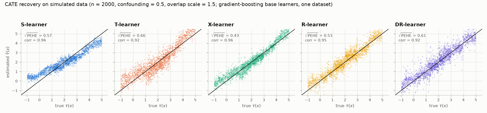
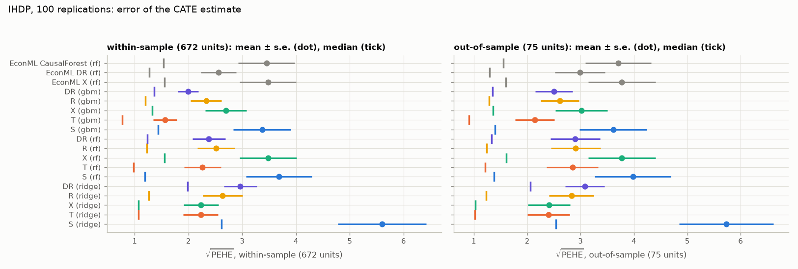
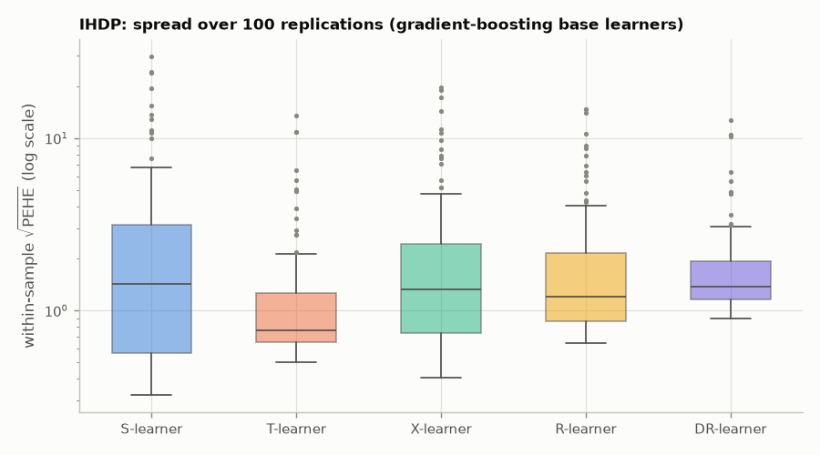
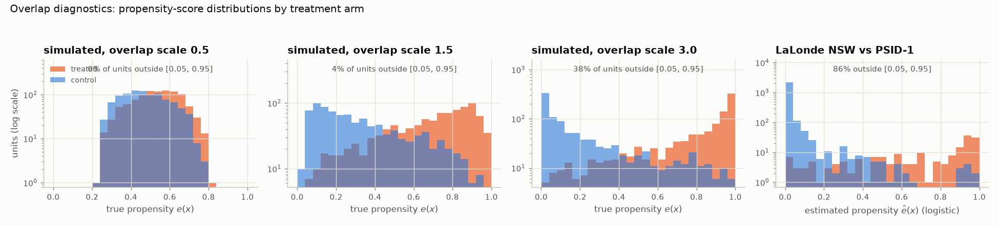
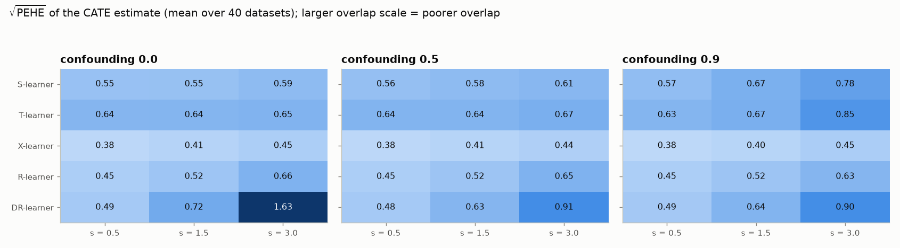
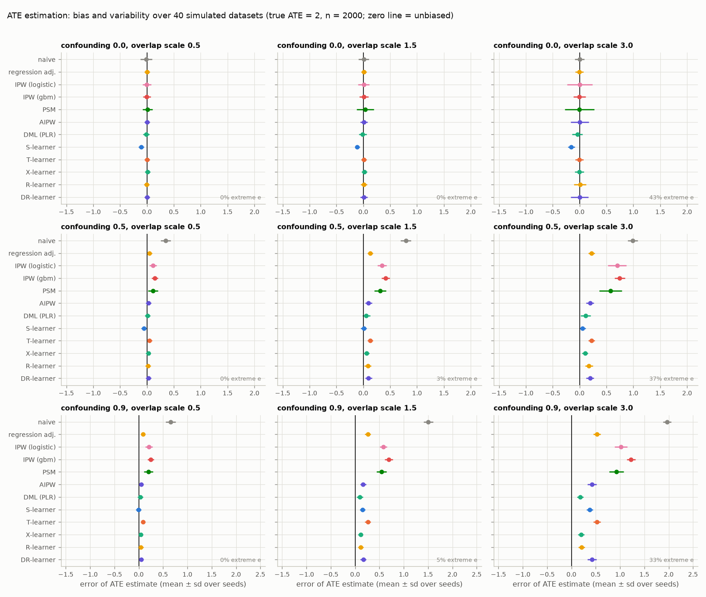
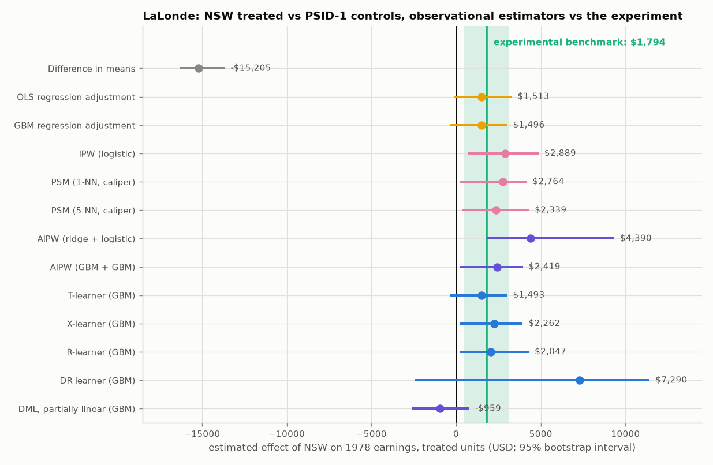
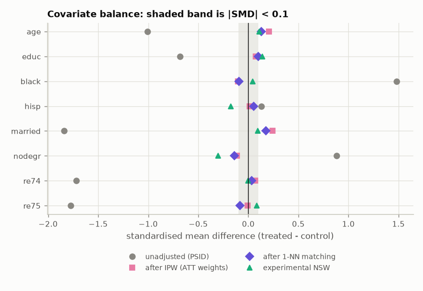

# causal-ml-meta-learners

Heterogeneous treatment-effect estimation from scratch: S-, T-, X-, R- and DR-learners, cross-fitted double ML, IPW, AIPW and propensity-score matching with bootstrap intervals, evaluated on IHDP, on simulated data with known CATE (varying confounding and overlap) and on the LaLonde NSW/PSID benchmark.

[](https://github.com/Jai-Advitheeya-Lella/causal-ml-meta-learners/actions/workflows/tests.yml)



This is a from-scratch reimplementation for learning and research. The meta-learners, the cross-fitting machinery, the ATE estimators, the matching code and the bootstrap are written here against NumPy; scikit-learn supplies the interchangeable base learners (random forests, gradient boosting) and EconML is used only as a baseline. A ridge regression and an L2 logistic regression are also implemented from scratch (`cml.models`) and can serve as base learners.

## Highlights

- **Five CATE learners** behind one interface (`fit(X, t, y)`, `predict(X)`, `ate()`, `att()`): S, T, X (Kunzel et al.), R (Nie and Wager, as a weighted pseudo-outcome regression) and DR (Kennedy).
- **Cross-fitting** with treatment-stratified folds; every nuisance prediction comes from a model that never saw that observation (unit-tested with a memorising model).
- **ATE / ATT estimators**: difference in means, regression adjustment, IPW (Horvitz-Thompson and Hajek), AIPW with influence-function standard errors, partially linear DML, and nearest-neighbour propensity matching with calipers; plus a stratified bootstrap that refits the whole pipeline.
- **Three evaluations**: IHDP (100 replications), a simulator with known ground-truth CATE on a 3 x 3 grid of confounding and overlap (40 datasets per cell), and LaLonde NSW vs PSID-1 against the experimental benchmark.
- **Tests**: base learners vs scikit-learn, R-loss equivalence, double robustness, cross-fitting independence, matching invariants, loaders vs published summary statistics, and agreement with EconML's X-learner.

## Results

Everything below comes from runs on this machine (CPU only; no GPU is needed for tree-based nuisance models). Timings were taken on a machine shared with other jobs.

### IHDP (Hill 2011), 100 replications

The 100-replication NPCI release (672 training and 75 test units per replication, ground-truth `mu0, mu1`, 25 covariates). Every learner is fitted on the 672 training units; sqrt(PEHE) = `sqrt(mean((tau_hat - tau)^2))` is reported within-sample (same 672 units) and out-of-sample (75 held-out units), as mean ± standard error over replications. `eps_ATE` is the absolute error of the average effect on the training units. Propensity model: logistic regression for the ridge base learner, otherwise the same family as the outcome model. Whole sweep: 100 replications x 18 configurations in about 6 minutes on 4 CPU processes.



| Base learner | Method | sqrt(PEHE) within-sample | sqrt(PEHE) out-of-sample | median within-sample | eps_ATE |
|---|---|---|---|---|---|
| ridge | S | 5.60 ± 0.82 | 5.73 ± 0.89 | 2.61 | 0.749 ± 0.140 |
| ridge | T | 2.23 ± 0.32 | 2.40 ± 0.40 | 1.07 | 0.134 ± 0.012 |
| ridge | X | 2.23 ± 0.32 | 2.41 ± 0.40 | 1.07 | 0.143 ± 0.013 |
| ridge | R | 2.63 ± 0.37 | 2.83 ± 0.42 | 1.27 | 0.211 ± 0.024 |
| ridge | DR | 2.96 ± 0.31 | 3.08 ± 0.37 | 1.98 | 0.248 ± 0.019 |
| rf | S | 3.68 ± 0.61 | 3.98 ± 0.71 | 1.19 | 0.423 ± 0.065 |
| rf | T | 2.26 ± 0.35 | 2.85 ± 0.49 | 0.98 | 0.134 ± 0.015 |
| rf | X | 3.48 ± 0.53 | 3.77 ± 0.63 | 1.56 | 0.220 ± 0.032 |
| rf | R | 2.51 ± 0.35 | 2.91 ± 0.47 | 1.22 | 0.371 ± 0.057 |
| rf | DR | 2.38 ± 0.30 | 2.90 ± 0.46 | 1.24 | 0.126 ± 0.010 |
| gbm | S | 3.37 ± 0.54 | 3.61 ± 0.63 | 1.43 | 0.245 ± 0.046 |
| gbm | T | 1.56 ± 0.22 | 2.15 ± 0.37 | 0.76 | 0.107 ± 0.009 |
| gbm | X | 2.70 ± 0.38 | 3.01 ± 0.49 | 1.33 | 0.221 ± 0.036 |
| gbm | R | 2.33 ± 0.29 | 2.61 ± 0.36 | 1.20 | 0.439 ± 0.068 |
| gbm | DR | 1.99 ± 0.19 | 2.50 ± 0.35 | 1.36 | 0.147 ± 0.011 |
| rf | EconML X-learner | 3.48 ± 0.53 | 3.77 ± 0.63 | 1.56 | 0.221 ± 0.032 |
| rf | EconML DR-learner | 2.56 ± 0.33 | 2.99 ± 0.47 | 1.27 | 0.182 ± 0.023 |
| rf | EconML CausalForestDML | 3.45 ± 0.52 | 3.71 ± 0.61 | 1.54 | 0.505 ± 0.089 |

ATE-only estimators on the same data:

| Estimator | eps_ATE (mean ± s.e.) | median |
|---|---|---|
| difference in means | 0.286 ± 0.039 | 0.150 |
| IPW (logistic) | 0.130 ± 0.013 | 0.113 |
| AIPW, cross-fit GBM | 0.148 ± 0.011 | 0.126 |
| DML partially linear, GBM | 0.744 ± 0.132 | 0.263 |



- The mean is dominated by a minority of replications with extreme outcomes (the mean exceeds the median by a factor of 1.5 to 3 for most rows), so the median column is the better guide to the typical replication. Standard errors are large relative to the differences between most rows: the S-learner with ridge is clearly the worst, and the T-learner with gradient boosting has the lowest mean, but its lead over the DR-learner with gradient boosting (1.99 ± 0.19) is within about two standard errors.
- The best configuration here is the T-learner with gradient boosting (mean 1.56 within-sample, 2.15 out-of-sample). The S-learner is the worst for ridge, as expected: with a linear model the treatment enters additively and the estimated effect is a constant. These numbers are **not** at the level reported for tuned neural representation learners such as TARNet / CFR (around 0.7 to 0.9 within-sample in Shalit et al., 2017, on a different replication set); the base learners here are used with fixed settings and no tuning.
- Our X-learner and EconML's X-learner give the same numbers to the printed precision with the same random-forest base learners (3.48 within-sample), which is a useful end-to-end check of the implementation. The DR-learner differs (2.38 vs 2.56) because the two implementations do not share fold splits and nuisance details.
- DML with a partially linear model estimates a variance-weighted average of heterogeneous effects, not the sample ATE, and has the largest `eps_ATE` here; the AIPW score (which targets the ATE) does not.

### Simulated data with known CATE: confounding and overlap

Data-generating process (see `cml/data/synthetic.py`): `X ~ U(-1,1)^10`, `mu0(x) = sin(pi x1 x2) + 2 (x3 - 1/2)^2 + x4 + x5/2`, `tau(x) = 1 + 2 x1 + 2 * 1[x2 > 0]` (ATE = 2), unit noise. Treatment is `Bernoulli(e(x))` with `logit e(x) = s (rho z_prog + sqrt(1 - rho^2) z_other)`: `rho` is the confounding strength (how closely treatment follows the prognostic score `mu0`) and `s` the overlap scale (large `s` drives `e(x)` towards 0 and 1). 40 datasets of n = 2000 for each of the 9 cells; all learners use gradient-boosting base models; ATE error is relative to the sample ATE. The full grid (360 datasets, 12 estimators each) took 15 minutes on 4 CPU processes.







Bias and standard deviation of the ATE error (40 datasets) at three representative settings:

| Estimator | no confounding, good overlap (rho 0, s 0.5) | strong confounding, moderate overlap (rho 0.9, s 1.5) | strong confounding, poor overlap (rho 0.9, s 3) |
|---|---|---|---|
| difference in means | -0.01 ± 0.11 | 1.51 ± 0.10 | 1.97 ± 0.08 |
| regression adjustment (GBM) | 0.00 ± 0.05 | 0.26 ± 0.06 | 0.52 ± 0.08 |
| IPW (logistic propensity) | -0.00 ± 0.08 | 0.58 ± 0.08 | 1.02 ± 0.13 |
| IPW (GBM propensity, in-sample) | -0.00 ± 0.08 | 0.70 ± 0.08 | 1.23 ± 0.09 |
| propensity matching (1-NN) | 0.01 ± 0.09 | 0.55 ± 0.10 | 0.93 ± 0.15 |
| AIPW (cross-fit GBM) | 0.00 ± 0.05 | 0.17 ± 0.06 | 0.42 ± 0.09 |
| DML, partially linear (GBM) | -0.02 ± 0.06 | 0.10 ± 0.06 | 0.18 ± 0.07 |
| T-learner | 0.00 ± 0.05 | 0.26 ± 0.06 | 0.52 ± 0.08 |
| X-learner | 0.01 ± 0.05 | 0.11 ± 0.05 | 0.20 ± 0.06 |
| R-learner | -0.01 ± 0.05 | 0.11 ± 0.05 | 0.21 ± 0.06 |
| DR-learner | 0.00 ± 0.05 | 0.17 ± 0.06 | 0.42 ± 0.09 |

(entries are bias ± sd; the S-learner and the other cells are in `results/synthetic_ate_summary.csv`.)

- **Confounding** biases the naive contrast by up to 1.97 (about the size of the ATE itself); every adjusted estimator reduces it, but with a flexible regularised model the residual bias grows with confounding and with poor overlap. The cross-fitted, orthogonalised estimators (DML, R-, X-learner) have the smallest bias in the hardest cell; plain regression adjustment / T-learner inherit the regularisation bias of the outcome model.
- **IPW and matching have the largest bias among the adjusted estimators here**, and at poor overlap logistic IPW and matching also have larger variance than AIPW. The logistic propensity is misspecified for this non-linear assignment, and the in-sample GBM propensity is overfit (not cross-fitted); with the poor-overlap setting 33 to 43% of units have `e(x)` outside [0.05, 0.95].
- **Overlap** mostly inflates variance when there is no confounding (rho = 0, s = 3: standard deviation 0.24 for logistic IPW and 0.28 for matching against 0.08 to 0.12 for regression adjustment, the T-, X- and R-learners and DML) and shows up in CATE accuracy: the DR-learner's sqrt(PEHE) rises from 0.49 (s = 0.5) to 1.63 (s = 3, no confounding) because its pseudo-outcome divides by `e(1-e)`, whereas the X- and R-learners stay between 0.38 and 0.66 in every cell.
- The X-learner has the lowest sqrt(PEHE) in every cell (0.38 to 0.45) on this design, whose effect is smooth in x1 and piecewise in x2.

### LaLonde (1986) and Dehejia-Wahba (1999): NSW vs PSID

The randomised National Supported Work experiment (185 treated, 260 control; Dehejia-Wahba subsample with 1974 earnings) gives the benchmark effect on 1978 earnings: **$1,794** (difference in means, standard error $671, 95% interval [$479, $3,109]). We then discard the experimental controls and use the 185 treated men with 2,490 PSID-1 controls, a classic test of whether observational methods can recover the experiment. Covariates: age, education, black, Hispanic, married, no degree, 1974 and 1975 earnings plus squares and zero-earnings indicators (16 features). All estimands are the ATT, intervals are 95% percentile bootstrap intervals (100 resamples, every model refitted each time); the whole run took 6 minutes on 4 CPU processes.



| Family | Estimator | ATT estimate (USD) | 95% bootstrap interval | covers benchmark |
|---|---|---|---|---|
| naive | Difference in means | -15,205 | [-16,325, -13,656] | no |
| outcome | OLS regression adjustment | 1,513 | [-123, 3,284] | yes |
| outcome | GBM regression adjustment | 1,496 | [-389, 3,008] | yes |
| propensity | IPW (logistic) | 2,889 | [668, 4,859] | yes |
| propensity | PSM (1-NN, caliper) | 2,764 | [230, 4,159] | yes |
| propensity | PSM (5-NN, caliper) | 2,339 | [323, 4,297] | yes |
| doubly robust | AIPW (ridge + logistic) | 4,390 | [1,843, 9,328] | no |
| doubly robust | AIPW (GBM + GBM) | 2,419 | [240, 3,937] | yes |
| meta-learner | T-learner (GBM) | 1,493 | [-392, 3,007] | yes |
| meta-learner | X-learner (GBM) | 2,262 | [233, 3,926] | yes |
| meta-learner | R-learner (GBM) | 2,047 | [238, 4,289] | yes |
| meta-learner | DR-learner (GBM) | 7,290 | [-2,409, 11,422] | yes |
| doubly robust | DML, partially linear (GBM) | -959 | [-2,622, 775] | no |



- The naive PSID contrast is off by $17,000 and has the wrong sign. Adjusting for covariates brings nine of the twelve adjusted estimators within about $1,100 of the benchmark, and their intervals contain it. The result is the standard one in this literature: with these covariates, conditioning on observables recovers the experiment approximately.
- The overlap is poor, and the intervals reflect it. With the logistic propensity, 86% of the 2,675 units have `e` outside [0.05, 0.95]; under the ATT weights the 2,490 controls have an effective sample size of 11, and 1-NN matching uses only 58 distinct controls for the 185 treated men. The intervals are mostly $3,400 to $4,200 wide (the AIPW ridge and DR-learner intervals are $7,500 and $13,800 wide), no estimator is clearly better than another, and three are off: the DR-learner (7,290) and AIPW with a ridge outcome model (4,390) are driven by large inverse-propensity weights, and the partially linear DML estimate (-959) targets a variance-weighted average rather than the ATT.
- Matching with replacement and the bootstrap do not mix well in theory (Abadie and Imbens, 2008), so the two PSM intervals are indicative only. Agreement here does not show that unconfoundedness holds in general: Smith and Todd (2005) show the PSID/NSW conclusions are sensitive to the sample and specification.

## How it works

Potential outcomes `Y(0), Y(1)`; the CATE is `tau(x) = E[Y(1) - Y(0) | X = x]`. Write `mu_a(x) = E[Y | X = x, T = a]`, `e(x) = P(T = 1 | X = x)`, `m(x) = E[Y | X = x]`.

- **S-learner**: one regression `mu(x, t)`, `tau = mu(x, 1) - mu(x, 0)`. **T-learner**: `tau = mu_1 - mu_0` from two regressions.
- **X-learner**: impute `D1_i = Y_i - mu_0(x_i)` (treated), `D0_i = mu_1(x_i) - Y_i` (controls), regress each on `x` to get `tau_1, tau_0`, and blend with the propensity: `tau(x) = e(x) tau_0(x) + (1 - e(x)) tau_1(x)`.
- **R-learner**: with cross-fitted `m, e`, minimise the Robinson loss

  $$\hat\tau = \arg\min_\tau \sum_i \big[(Y_i - \hat m(X_i)) - (T_i - \hat e(X_i))\,\tau(X_i)\big]^2,$$

  implemented as a weighted regression of `(Y - m)/(T - e)` on `x` with weights `(T - e)^2`. A unit test checks that this equals the direct least-squares minimiser for a linear `tau`.
- **DR-learner**: regress the doubly robust pseudo-outcome

  $$\phi_i = \hat\mu_1(X_i) - \hat\mu_0(X_i) + \frac{T_i - \hat e(X_i)}{\hat e(X_i)(1 - \hat e(X_i))}\big(Y_i - \hat\mu_{T_i}(X_i)\big)$$

  on `x`. Its mean is `tau(x)` if either the outcome models or the propensity are right, and the bias is the product of the two nuisance errors.
- **AIPW / DML**: the sample mean of `phi` is the cross-fitted AIPW estimate of the ATE with standard error `sd(phi)/sqrt(n)`; the ATT version uses `[T (Y - mu_0) - (1 - T) e/(1 - e) (Y - mu_0)] / P(T = 1)`. The partially linear DML estimator is `sum (T - e)(Y - m) / sum (T - e)^2` with a sandwich variance.
- **Cross-fitting**: `K = 5` treatment-stratified folds; nuisances for a fold are fitted on the other four. Propensities are clipped (default `[0.01, 0.99]`; the LaLonde runs use `1e-3` for AIPW and `1e-4` for IPW and matching).
- **Matching**: nearest neighbours in the logit propensity, with replacement, caliper `0.25 sd(logit e)`.

## Quickstart

```bash
uv venv --python 3.12 .venv && source .venv/bin/activate
uv pip install -r requirements.txt && uv pip install -e .
uv pip install econml          # optional: EconML baselines in the IHDP run and one test

pytest -q                      # unit tests; the data tests download IHDP / LaLonde (skipped when CI is set)

python scripts/run_ihdp.py --reps 100 --workers 4            # ~6 min   -> results/ihdp.jsonl
python scripts/run_synthetic.py --seeds 40 --n 2000 --workers 4   # ~15 min -> results/synthetic*.{jsonl,npz,json}
python scripts/run_lalonde.py --boot 100 --workers 4         # ~6 min   -> results/lalonde.json
python scripts/make_figures.py ihdp && python scripts/make_figures.py synthetic && python scripts/make_figures.py lalonde
```

```python
from cml import DRLearner, make_synthetic, SyntheticConfig, sqrt_pehe, aipw, bootstrap

d = make_synthetic(SyntheticConfig(n=2000, confounding=0.7, overlap_scale=1.0, seed=0))
m = DRLearner(outcome_model="gbm", propensity_model="gbm").fit(d.X, d.t, d.y)
print(sqrt_pehe(m.predict(d.X), d.tau), m.ate())

est = aipw(d.X, d.t, d.y, "gbm", "gbm", estimand="ate")   # est.value, est.se, est.ci
boot = bootstrap(aipw, d.X, d.t, d.y, n_boot=200, outcome_model="ridge", propensity_model="logistic")
```

## Project structure

```
src/cml/
  models.py        from-scratch ridge and logistic regression; base-learner factories (ridge, lasso, rf, gbm)
  nuisance.py      stratified folds and cross-fitted propensity / outcome models
  metalearners.py  S, T, X, R and DR learners
  estimators.py    difference in means, regression adjustment, IPW, AIPW, DML (PLR), PSM, bootstrap
  diagnostics.py   standardised mean differences, effective sample size, overlap summary
  metrics.py       sqrt(PEHE), ATE error
  data/            IHDP, LaLonde (NSW and PSID-1) loaders and the simulator with known CATE
tests/             correctness and invariance tests
scripts/           experiment runners and figure generation (run from the repository root)
results/           raw per-run results and the tables above
assets/            figures
```

## References

- S. Kunzel, J. Sekhon, P. Bickel, B. Yu, *Metalearners for estimating heterogeneous treatment effects using machine learning*, PNAS 2019. [arXiv:1706.03461](https://arxiv.org/abs/1706.03461)
- V. Chernozhukov et al., *Double/debiased machine learning for treatment and structural parameters*, The Econometrics Journal, 2018. [arXiv:1608.00060](https://arxiv.org/abs/1608.00060)
- X. Nie and S. Wager, *Quasi-oracle estimation of heterogeneous treatment effects*, Biometrika 2021. [arXiv:1712.04912](https://arxiv.org/abs/1712.04912)
- E. H. Kennedy, *Optimal doubly robust estimation of heterogeneous causal effects*, 2020. [arXiv:2004.14497](https://arxiv.org/abs/2004.14497)
- J. L. Hill, *Bayesian nonparametric modeling for causal inference*, JCGS 2011.
- U. Shalit, F. Johansson, D. Sontag, *Estimating individual treatment effect: generalization bounds and algorithms*, ICML 2017. [arXiv:1606.03976](https://arxiv.org/abs/1606.03976) (source of the IHDP replication files used here)
- R. J. LaLonde, *Evaluating the econometric evaluations of training programs with experimental data*, American Economic Review 1986.
- R. Dehejia and S. Wahba, *Causal effects in nonexperimental studies*, JASA 1999; data from [users.nber.org/~rdehejia](https://users.nber.org/~rdehejia/data/).
- J. Smith and P. Todd, *Does matching overcome LaLonde's critique of nonexperimental estimators?*, Journal of Econometrics 2005.
- A. Abadie and G. Imbens, *On the failure of the bootstrap for matching estimators*, Econometrica 2008.
- Baseline: [EconML](https://github.com/py-why/EconML) (`XLearner`, `DRLearner`, `CausalForestDML`).

## License

MIT, see [LICENSE](LICENSE).
